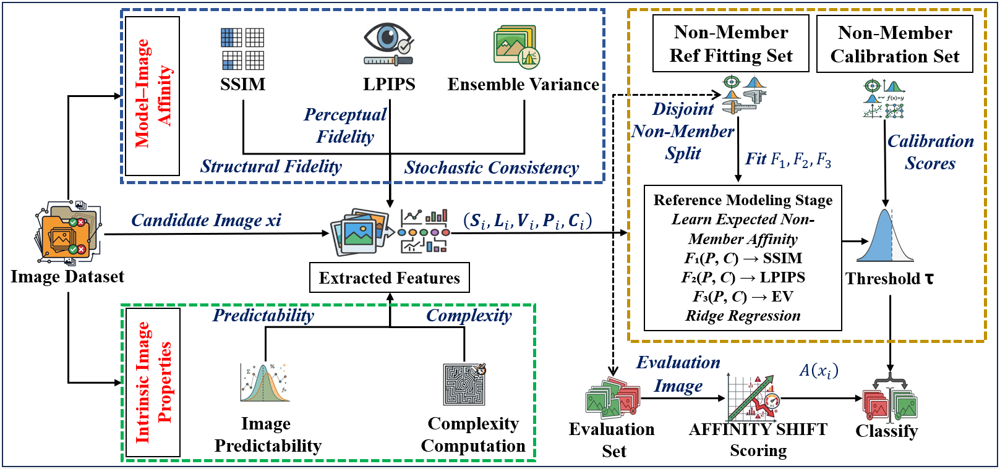

# AffinityShift

**Membership Inference for Diffusion Models via Intrinsic-Property-Conditioned Model–Image Affinity**

This repository contains the implementation of **AffinityShift**, a weakly supervised, one-class membership inference framework for diffusion models.

## 🔍 Framework Overview

<p align="center">
  
</p>

## Requirements

- Python 3.10+
- PyTorch with CUDA support
- Diffusers, Transformers, Accelerate, PEFT
- LPIPS, scikit-image, OpenCV
- NumPy, pandas, scikit-learn, Pillow, torchvision

```bash
pip install torch torchvision diffusers transformers accelerate peft lpips scikit-image opencv-python numpy pandas scikit-learn openpyxl pillow tqdm
```

## Repository Structure

```text
AffinityShift/
├── README.md
├── overview.png
├── finetune.py
├── affinity_metrics.py
├── image_predictibility.py
├── complexity.py
└── classify.py
```

## Dataset Preparation

We use **MS-COCO** and **Flickr30k**, following the experimental settings described in:

- [Noise as a Probe — Lian et al.](https://arxiv.org/abs/2601.21628)
- [SimA — Official GitHub Repository](https://github.com/mx-ethan-rao/SimA)

The SimA repository provides experimental configurations and dataset-split information for Stable Diffusion v1.4.

Each image must have a corresponding `.txt` file containing its text prompt.

```text
dataset/
├── member/
│   ├── image001.jpg
│   └── image001.txt
└── non_member/
    ├── image002.jpg
    └── image002.txt
```

Only member images are used for fine-tuning.

## 1️⃣ Model–Image Affinity

### 🔹 Fine-Tuning Stable Diffusion v1.4

```bash
python finetune.py \
  --pretrained-model /path/to/model \
  --member-dir /path/to/dataset/member \
  --output-dir /path/to/output \
  --dataset mscoco
```

Use `--dataset flickr30k` for Flickr30k.

### 🔹 Affinity Extraction

Compute **SSIM, LPIPS, and Ensemble Variance** using the pretrained and fine-tuned diffusion models.

```bash
python affinity_metrics.py \
  --pretrained-model /path/to/sd-v1-4 \
  --finetuned-model /path/to/output/pipeline \
  --input-dir /path/to/dataset/member \
  --output-csv results/member_affinity.csv \
  --reconstruction-dir results/reconstructions
```

Repeat for non-member images using the same target-model checkpoint.

## 2️⃣ Intrinsic Image Properties

This pathway computes two target-model-independent features: **Image Predictability** and **Complexity**.

### 🔹 Image Predictability

Estimate image predictability using the pretrained [SReC model](https://github.com/caoscott/SReC).

```bash
python image_predictibility.py \
  --file images.txt \
  --load /path/to/srec_checkpoint.pth \
  --srec-repo /path/to/SReC \
  --output-csv results/predictability.csv \
  --mode official-bpsp
```

**Note:** `official-bpsp` produces a predictability proxy. Reproducing the paper's local/global predictability requires `paper-dual-context` mode with a verified probability extractor.

### 🔹 Image Complexity

Compute complexity using six image descriptors: edge density, gradient magnitude, Laplacian variance, Shannon entropy, colorfulness, and JPEG PSNR.

Fit normalization statistics using reference-fitting non-members:

```bash
python complexity.py fit \
  --images nonmember_reference.txt \
  --stats results/complexity_stats.json \
  --output-csv results/reference_complexity.csv
```

Apply the saved statistics to other images:

```bash
python complexity.py transform \
  --images evaluation_images.txt \
  --stats results/complexity_stats.json \
  --output-csv results/evaluation_complexity.csv
```

## 3️⃣ Reference-Based Membership Detection

Combine the affinity measurements and intrinsic properties into a single CSV or Excel file.

Required columns:

```text
Source,Image_Predictability,Complexity,SSIM,LPIPS,Ensemble_Variance
```

Run the ridge-regression-based membership detector:

```bash
python "ridge regression with classify.py" \
  --input /path/to/combined_features.xlsx \
  --output results/affinityshift_predictions.xlsx \
  --summary results/affinityshift_summary.json
```

The detector fits non-member reference functions, computes directional affinity-shift scores, calibrates a decision threshold, and produces membership predictions.

## Reproducibility

Use the same dataset partitions, model checkpoints, image captions, and preprocessing settings. Reference fitting, normalization, and calibration must use the appropriate disjoint non-member subsets.


